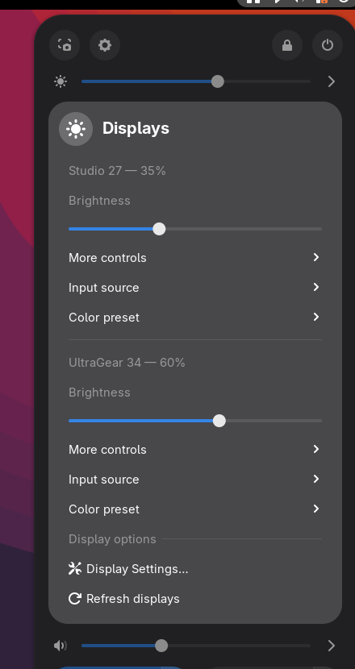
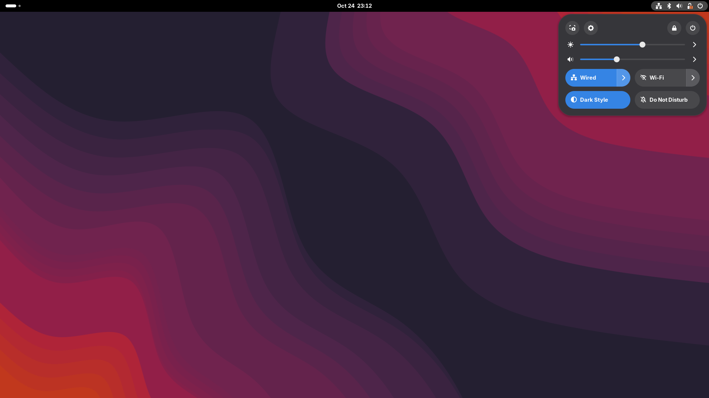
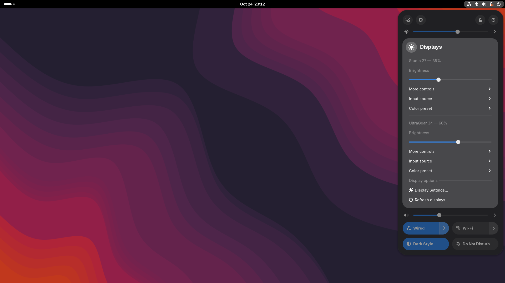
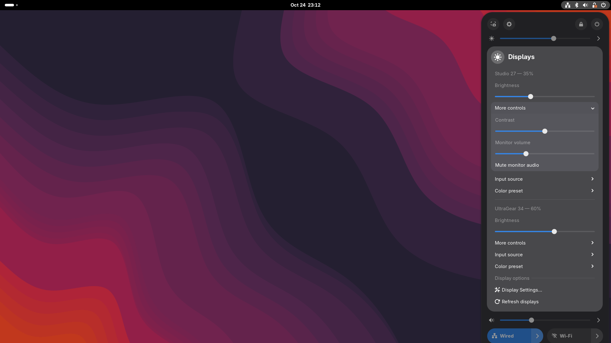
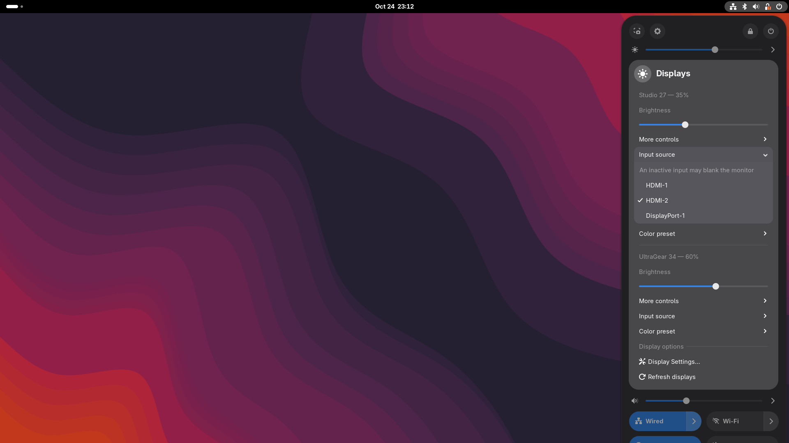
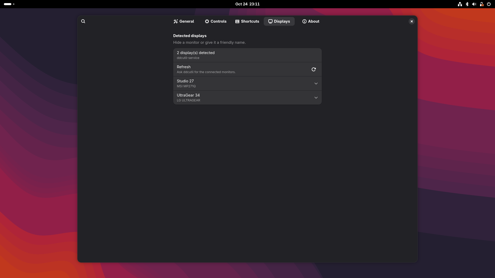

# Veld Monitor Controls

**Real brightness and display controls for external monitors, right in GNOME Quick Settings.**

Veld Monitor Controls adds a native master brightness slider above GNOME's volume
slider and gives every DDC/CI-capable monitor its own controls for brightness,
contrast, input, color and audio.

[Project page](https://veldhost.eu/open-source/veld-monitor-controls) ·
[Source code](https://github.com/Veldhost/veld-monitor-controls) ·
[Report an issue](https://github.com/Veldhost/veld-monitor-controls/issues)

> **GNOME Extensions listing:** coming soon. Until it is approved, install from
> the latest GitHub release or build from source.



## Why another DDC extension?

Most external monitors ignore GNOME's built-in brightness slider. Veld Monitor
Controls speaks DDC/CI directly, so brightness changes happen in the monitor
itself — not through a dimming overlay.

It is designed to feel native:

- a master brightness slider beside GNOME's own sliders
- one section per monitor, with its own brightness and controls
- the fast `ddcutil-service` path when available, with automatic CLI fallback
- clear separation between monitor controls and global display options
- no extra panel icon, no ads and no telemetry

## Features

- **Master brightness slider** above or below GNOME volume
- **Per-monitor brightness** sliders with live percentages
- **Contrast**, **monitor volume**, **mute**, **input source**, **color preset**
  and optional **RGB gain**
- **OSD feedback** and configurable keyboard shortcuts
- **Friendly display names** and per-monitor visibility
- **Fast backend** using `ddcutil-service`, with automatic `ddcutil` CLI fallback
- **Input safety warning** before switching to an inactive input
- **Minimum brightness floor** by default to prevent a black screen
- **Setup checks** for ddcutil and ddcutil-service in preferences
- **Local only** — no network access, no telemetry

## Screenshots

| Quick Settings | Per-monitor controls |
|---|---|
|  |  |

| More monitor controls | Input switching |
|---|---|
|  |  |



## Requirements

- **GNOME Shell 49, 50 or 51**
- A monitor with **DDC/CI enabled** in its on-screen menu
- **`ddcutil`** installed and working for your user
- Access to `/dev/i2c-*` for your user

Optional but recommended:

- **`ddcutil-service`** for much faster slider response

## Setup

### 1. Install ddcutil

| Distribution | Command |
|---|---|
| Arch Linux | `sudo pacman -S ddcutil` |
| Fedora | `sudo dnf install ddcutil` |
| Debian / Ubuntu | `sudo apt install ddcutil` |

Make sure the `i2c-dev` module is loaded and your user can access the I2C
devices. On many distributions this means adding yourself to the `i2c` group:

```sh
sudo modprobe i2c-dev
sudo usermod -aG i2c "$USER"
```

Log out and back in after changing groups. Some distributions use different
udev rules or group names; see the
[ddcutil configuration guide](https://www.ddcutil.com/config_steps).

### 2. Verify ddcutil

```sh
ddcutil detect
```

You should see one entry per external monitor. If this requires `sudo`, fix the
device permissions first — the extension never runs privileged commands.

### 3. Optional: install ddcutil-service

`ddcutil-service` keeps libddcutil loaded and makes slider movement noticeably
smoother. It is available in the AUR and as unofficial packages for other
distributions:

- [ddcutil-service upstream](https://github.com/digitaltrails/ddcutil-service)
- [AUR package](https://aur.archlinux.org/packages/ddcutil-service)

The extension automatically uses the service when available and falls back to
the `ddcutil` command otherwise.

### 4. Install the extension

#### From a GitHub release

Download the `.shell-extension.zip` from the
[latest release](https://github.com/Veldhost/veld-monitor-controls/releases/latest), then:

```sh
gnome-extensions install --force veld-monitor-controls@veldhost.eu.shell-extension.zip
```

Log out and back in, then enable it (or switch it on in the Extensions app):

```sh
gnome-extensions enable veld-monitor-controls@veldhost.eu
```

GNOME Shell only discovers newly installed extensions when it starts, so
`gnome-extensions enable` reports that the extension "does not exist" until you
have logged out and back in.

#### From source

```sh
git clone https://github.com/Veldhost/veld-monitor-controls.git
cd veld-monitor-controls
make install
```

Log out and back in, then:

```sh
gnome-extensions enable veld-monitor-controls@veldhost.eu
```

## Usage

Open the Quick Settings system menu. The master brightness slider is placed
above volume by default. Use the chevron to open:

- one brightness slider per monitor
- **More controls** for contrast, monitor volume, mute and optional RGB gain
- **Input source** and **Color preset** submenus where supported
- **Display options** with display settings and a refresh action

The extension preferences let you choose the slider placement, write behavior,
visible controls, shortcuts, friendly display names and per-monitor visibility.

## Compatibility

The extension targets and lists GNOME Shell **49, 50 and 51**. Development and
primary testing happen on GNOME 51. If you find a version-specific issue, please
include your GNOME Shell version, distribution, monitor model and the output of
`ddcutil detect`.

## Privacy

Veld Monitor Controls is local-only:

- no telemetry
- no network requests
- no analytics
- no account

It talks to the monitor through `ddcutil` or the local `ddcutil-service` D-Bus
service. Settings are stored in GSettings; display names and visibility are
stored locally.

## Troubleshooting

### No displays detected

```sh
ddcutil detect
```

- Enable DDC/CI in the monitor's own menu.
- Check `/dev/i2c-*` permissions and group membership.
- Try another cable or port; some KVM switches and USB-C hubs do not pass DDC.
- Some monitors need a few seconds after wake-up before they answer.

### Monitor went black at 0%

The default minimum is 1%. If the monitor is unresponsive, use its physical
buttons or:

```sh
ddcutil setvcp 10 50 --bus <bus-number>
```

`ddcutil detect` prints the bus number.

### The screen went blank after switching input

Switching to an input with no active signal can darken the monitor. Use its
physical input button to switch back. This is monitor behavior, not an extension
bug.

### Slider feels slow

Install `ddcutil-service`. The CLI fallback starts a new process for every
change. You can also increase the write interval in preferences.

### Debug logging

Enable **Debug logging** in preferences and inspect the journal:

```sh
journalctl -f -o cat /usr/bin/gnome-shell
```

## Development

```sh
make check       # unit tests, lint, schema validation
make install     # install into the current user's extension directory
make release     # build and validate a clean EGO-ready zip
make pack        # alias for make release
```

The mock backend is useful for UI development:

```sh
VMC_MOCK=1 ./dev/run-nested.sh
```

See [CONTRIBUTING.md](CONTRIBUTING.md) for details.

## License

GPL-2.0-or-later. See [LICENSE](LICENSE).

Veld Monitor Controls is a [Veldhost](https://veldhost.eu) open-source project.
